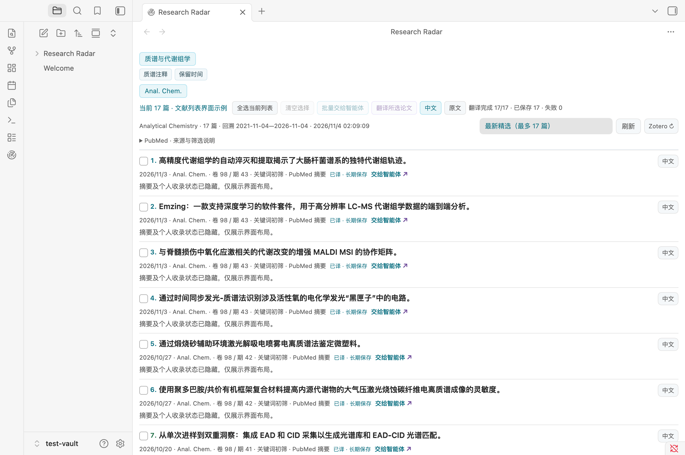
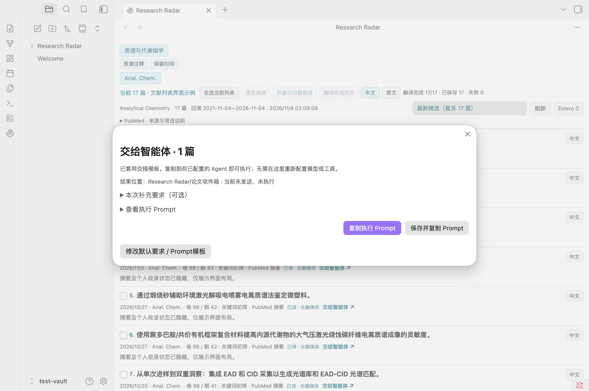

# Research Radar

**0.4.3 · Private desktop preview for Obsidian.** A configurable literature workspace with topics, journal sources, keyword filters, manual translation and optional read-only Zotero status. It runs without Hearth or a fixed Markdown note.

The repository and prerelease are private. An open-source license has not been selected. See [LICENSE](LICENSE) and [Rights and attribution](RIGHTS.md); access does not grant redistribution permission.

## Quick start

1. With the owner's authorization, download the ZIP from this repository's Releases page. Put its `research-radar` folder into your vault's `.obsidian/plugins/` directory.
2. Enable the plugin and open its ribbon icon or the “打开论文雷达” command.
3. Edit topics, sources and keyword rules in Settings → Research Radar, then save. The initial profile is a generic example; no personal library is bundled.
4. Translation is disabled by default. Select Ollama or an online service, save, check the connection and test a short sentence before selecting papers. Online translation requires explicit consent; paid services require your own API credentials.
5. Give [AGENT.md](AGENT.md) and [example-profile.json](example-profile.json) to your existing Agent to generate a profile. Import, preview and apply it in the plugin. Profile changes preserve local integrations.

## Workflow

Discover → filter → select → manually translate → copy an Agent Prompt or save tasks. Default reading instructions and optional research context live in settings. The generated Prompt includes bibliographic identity, source abstracts and, after saving, exact task note paths. Paste and send it to your existing Agent; the plugin does not launch an Agent, download PDFs or write to Zotero.

Zotero colors are optional: default means unmatched after a successful check, red means a readable local article PDF was detected, green means the item exists without a detected readable article PDF, and amber means unknown/disconnected. PDF detection does not certify content completeness.

Screenshots show the isolated test vault. Abstracts and personal Zotero matches are hidden for publication.

## Requirements and limits

Obsidian 1.13.7+ on desktop. Runtime verified on macOS only; Windows/Linux remain unverified. Ollama, models and Zotero are installed separately. Background hover and language toggles only read cached translations. Publication metadata may be delayed, missing or incomplete; ranking is not peer review.

Google/Bing anonymous web services are experimental. MyMemory has limited anonymous quota. Microsoft/DeepL and AI APIs require an eligible account and may charge; a chat subscription is not an API entitlement. Keyed services have protocol tests, not a blanket live-account availability guarantee. The plugin uses Obsidian SecretStorage references; it does not bundle shared keys or read other applications' credentials.

## Network and privacy

Discovery uses configured PubMed, Crossref, Europe PMC or allowlisted RSS domains. Translation sends only selected titles/abstracts to the chosen service after consent. Zotero uses a local read-only API and may inspect local attachment headers. Clicking an original opens its website. No built-in telemetry. See [Security](docs/SECURITY.md) for exact destinations, local files and Agent boundaries.

## Documentation and feedback

[Chinese guide](docs/USER-GUIDE.md) · [Security](docs/SECURITY.md) · [Agent guide](AGENT.md) · [Acceptance record](docs/STATUS.md) · [Changelog](CHANGELOG.md) · [Publication plan](docs/PUBLISHING.md).

Report a minimal reproduction using the repository issue template. Remove credentials, private project context, PDFs and runtime data first. Development: Node.js 20+, `npm ci`, `npm test`, `npm run build`, `npm run package`. Tests do not constitute an independent security audit or scientific validation. This preview is not listed in the Obsidian community directory.

Zotero setup is also available as a copyable, vault-scoped Agent Prompt from settings or the command palette. See [the Zotero guide](docs/ZOTERO.md). Red = matched with a readable local article PDF; green = matched without a verified local PDF; amber/? = unverified. Original color means unmatched only after a successful enabled check.
