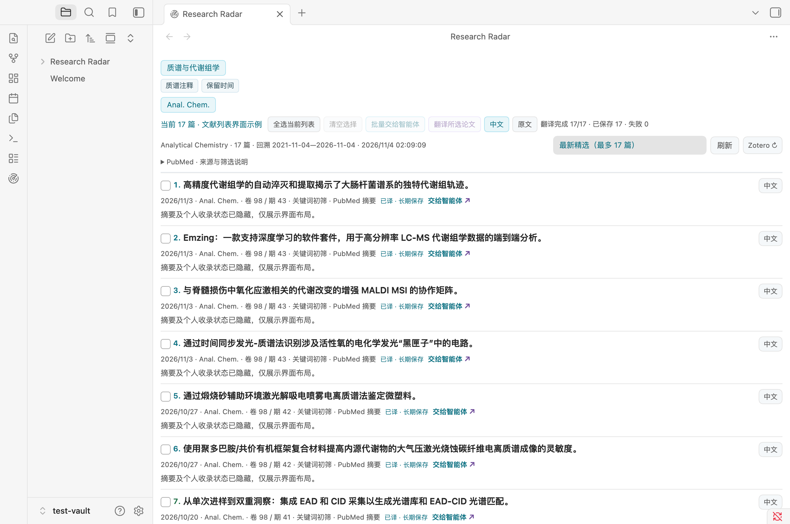
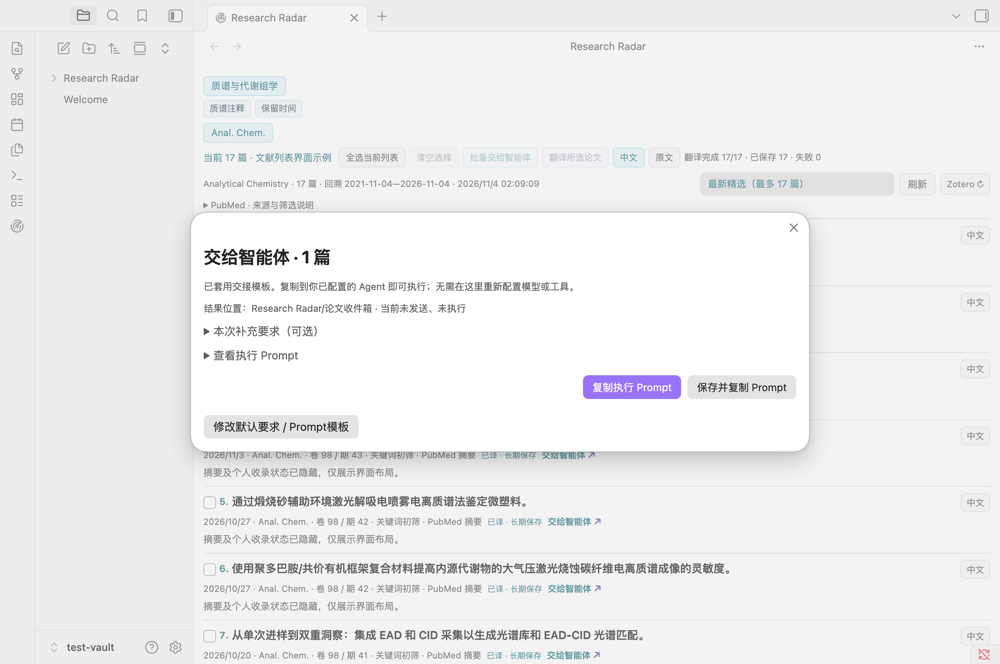

# Research Radar

**0.4.5 开源桌面测试版** · 独立 Obsidian 科研文献工作台。无需 Hearth 或固定 MD 文件。

[English](README.en.md) · [更新记录](CHANGELOG.md) · [发布计划](docs/PUBLISHING.md) · [权利与署名](RIGHTS.md)

项目按 **Apache License 2.0** 开源，版权署名为 iduoduo；可从 GitHub Releases 下载桌面测试版。最低版本按已实测的 Obsidian 1.13.7 标注；macOS 已实测，Windows/Linux 尚未实机验收。尚未提交 Obsidian 社区市场。

## 先读这里

| 文档 | 内容 |
|---|---|
| [安装与使用说明](docs/USER-GUIDE.md) | 安装升级、首次配置、本地与在线翻译设置、主题/期刊/关键词、排障 |
| [安全配置说明](docs/SECURITY.md) | 数据去向、Agent 权限、个人信息与资源控制、备份恢复 |
| [Zotero联动与Agent配置](docs/ZOTERO.md) | 一键Prompt、本机连接、颜色图例和全文核验 |
| [Agent 配置指南](AGENT.md) | 可复制提示词、JSON格式、手动导入、自动 API、验收 |
| [验收记录](docs/STATUS.md) | 本版实际验证、缺口、历史记录 |
| [示例主题方案](example-profile.json) | 可以交给 Agent 修改后导入的完整 JSON |

**Obsidian 中直接阅读**：设置 → Research Radar →「安装与使用说明 / 安全配置说明 / Agent 配置指南 / 验收记录」。帮助内容打包在程序里，不依赖隐藏目录中的 MD 链接。命令面板也有「Research Radar: 安装与使用说明」。

## 快速开始

1. 将 ZIP 内 `research-radar` 文件夹放到目标库 `.obsidian/plugins/`，启用插件。
2. 点击左侧雷达图标打开独立面板。
3. 在设置页配置主题和来源，点击**保存设置**。初装只有一组示例，不包含作者的个人文库。
4. 翻译默认关闭：在设置中选择本地 Ollama 或在线服务，启用并**保存设置** → **检查连接与模型** → **试译一句** → 勾选论文并翻译。在线服务需另开“允许在线发送”；API服务需个人密钥。
5. 需要 Agent 个性化配置时，把 AGENT.md 和示例 JSON 交给 Agent，生成方案后在导入窗口预览、应用。

本机示例：地址 `http://127.0.0.1:11434`，模型 `hy-mt2:latest`。必须先安装该模型；GGUF 路径、llama.cpp 的端口或 `/v1` 不是这里的模型名称/服务地址。

## 功能与边界

- 多主题、期刊、关键词即时筛选、历史/最新列表、种子关联与跨来源选择。
- 手动本地或在线标题/摘要翻译、长期保存、原文/中文切换。悬停不推理；暂停后当前请求可能继续。
- 可选本机 Zotero 只读条目/PDF 标记：原色未匹配、红色有本地论文 PDF、绿色已收录无本地 PDF；断线为琥珀待核。支持单独重试及可见面板恢复核对。颜色不是全文完整性认证。
- 论文任务保存和复制；**不自动发送到 Codex、不自动下载全文或归档到 Zotero**。
- Agent JSON 配置校验、预览、版本冲突检查和上一版恢复。

候选论文来自在线元数据，最多100篇不是全过刊覆盖。科研相关性需要人判断。旧 Hearth 版配置和译文不自动迁移。

## 维护顺序

保留 Hearth Research Radar 与独立 Research Radar 两个插件。新功能先在 Hearth 版开发并验证，再按明确范围同步独立版；独立版不替换或停用 Hearth，不自动迁移个人缓存。0.3.1 已同步 Hearth 0.1.15 的 Zotero 断线与恢复处理。本次0.4.0依用户明确要求直接扩展独立版翻译，不修改Hearth版。

## 升级与开发

升级前停用并备份旧插件目录，覆盖程序和文档，保留自己的 data.json。详见安装手册；不要用旧 Hearth 的 data.json 覆盖独立版。

Node.js 20+：`npm ci` → `npm test` → `npm run build` → `npm run package`。构建输出在 dist，分发包在 release。打包前重建并校验文档非空、内部链接和白名单，附 SHA256。

本项目自 0.4.4 起采用 [Apache License 2.0](LICENSE)。使用和分发时遵守许可，保留版权、许可和 [NOTICE](NOTICE)，修改文件应标明变更。允许商业使用和闭源衍生；不要求公开全部修改，也不授予项目名称或标识的商标权。第三方组件保留其自身许可。详见[权利与署名](RIGHTS.md)和[第三方声明](THIRD-PARTY-NOTICES.md)。

## Agent交接模板（0.4.1）

设置 → Research Radar → **Agent论文交接**：保存默认处理要求、研究背景和可选自定义Prompt模板。沿用你已经配置好的Agent，无需在插件里再设置模型、工具或固定聊天。

勾选论文 → 交给智能体 → **复制执行Prompt**，粘贴给Agent发送即可；如需沉淀任务，点**保存并复制Prompt**。自动携带标题、DOI/PMID、原文、主题、期刊和来源摘要；保存后复制还附实际任务笔记路径。补充要求和预览默认折叠，不再出现必填空白要求框。

默认流程涵盖查重、合法全文、Zotero既有分类、创新/证据/局限/项目借鉴与结果回写。插件仅生成或保存Prompt，不启动Agent、下载或写Zotero；实际执行由接收Agent及已有工具完成。个人背景和交接模板不进入主题分享包。详见[使用说明](docs/USER-GUIDE.md)。

## 翻译服务（0.4.0）

参考 [Easydict 的多服务设计](https://github.com/tisfeng/Easydict/releases)，独立实现13个服务选项。不要把“有免费额度”当成无限免费。

| 类别 | 可选服务 | 使用条件 |
|---|---|---|
| 免密钥 | Google网页、Bing网页、MyMemory | Google/Bing是实验性网页接口；MyMemory匿名额度有限，适合少量论文 |
| 官方翻译API | 微软Translator、DeepL | 需要自己的API密钥；可申请F0/API Free，实际额度及费用以账户为准 |
| 主流AI | OpenAI、Gemini、Claude、通义千问、智谱GLM、DeepSeek | 各服务独立的API密钥和模型；通常按量计费，聊天订阅不等于API权限 |
| 自定义AI | Chat Completions兼容API | HTTPS基础地址、模型和此供应商自己的密钥引用 |
| 本地 | Ollama | 保留原有模型翻译，可能占用GPU |

路径：设置 → Research Radar → 翻译服务。选择服务、设置模型和密钥引用、开启手动翻译与在线发送授权 → 保存 → 检查连接 → 试译一句 → 勾选少量论文翻译。Gemini/Claude使用原生协议，OpenAI使用Responses，其余AI使用兼容协议；不能互换密钥或基础地址。

不会提供共享密钥、读取Easydict账户或调用其应用。密钥由Obsidian SecretStorage管理，配置只保存引用名；分享的主题方案不携带翻译配置。打开面板、悬停与语言切换均不请求翻译；服务失败暂停，不自动改用其他服务/本地模型。译文按服务和模型隔离缓存，旧译文保留。

**验收边界**：已验证Google真实标题/摘要链路和MyMemory真实短句/单篇摘要；Bing会受网页会话限制，须在自己网络先检查，不承诺可用。带密钥服务通过协议与缓存测试，未用个人付费账号验证。详细结果见[验收记录](docs/STATUS.md)，步骤见[使用说明](docs/USER-GUIDE.md)。

## 桌面测试反馈

通过仓库Issues提交最小复现：插件/Obsidian版本、系统、服务类型、操作步骤和脱敏错误。不要上传密钥、个人data.json、整个文库或全文PDF。代码贡献按 Apache-2.0 提交，详细流程见 [贡献说明](CONTRIBUTING.md)。

截图为隔离测试库的真实界面；摘要与个人 Zotero 收录状态在拍摄时隐藏，不包含私人库数据。

## 联网、账号与付费披露

文献发现访问PubMed、Crossref、Europe PMC和允许名单内的RSS；翻译仅在手动操作并获得相应授权后向选中服务发送标题/摘要。Zotero联动访问本机API，并可能读取库外论文附件的开头确认PDF。原文链接打开外部网站。插件没有内置遥测；基础阅读不要求插件账号，部分翻译需各服务自己的账号/API权限，可能收费。详细数据目的地见[安全说明](docs/SECURITY.md)。

## 反馈与持续改进

雷达工具栏的 **反馈与建议**、设置页的 **填写反馈**，以及命令面板的 **反馈问题 / 功能与体验建议**，均可打开反馈窗口。选择「问题反馈 / 功能建议 / 体验意见」，填写标题和具体内容，检查草稿后点击「在 GitHub 检查并提交」。浏览器需要登录自己的 GitHub 账号，再由你最终提交；可在同一个 Issue 中补充脱敏信息并跟踪回复、修复和版本。

也可以复制草稿，或通过[反馈列表](https://github.com/iduoduo1002/research-radar/issues)先看是否已有相同问题。长草稿或浏览器/剪贴板失败时，使用可展开预览手动复制，不自动重试或发送。

不自动上传日志、文库、论文、设置、研究背景或 Zotero 信息。草稿只自动带插件版本、Obsidian 版本和系统类型；点击打开 GitHub 后，草稿文本会通过 URL 查询参数发送给 GitHub，可能留在浏览器历史中。不要填入密钥或私人材料。维护者按问题复现、优先级和验证结果处理，再通过版本更新记录反馈；不承诺所有建议一定实现或固定时限。
